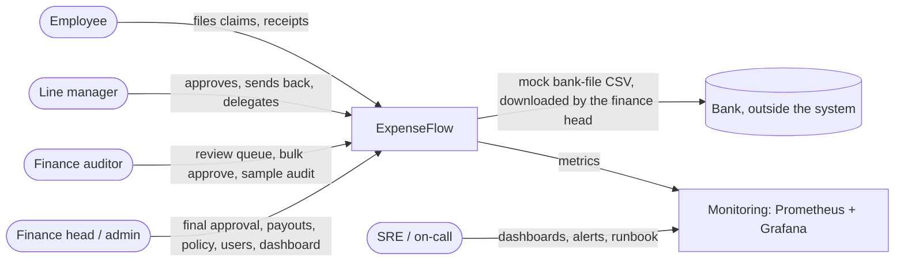
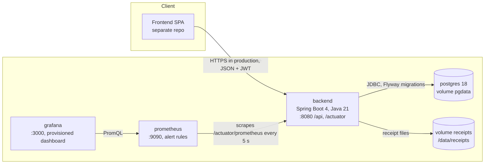

# ExpenseFlow architecture

Covers the use case's architecture deliverables: context and container diagrams, the policy-as-configuration design, a review of ways to bypass approvals, and pointers to the claim state machine ([`data-model.md`](data-model.md#claim-state-machine)) and the approval-chain ADR ([`adr/0001-approval-chain-model.md`](adr/0001-approval-chain-model.md)).

## Context

The bank is not integrated. The finance head downloads the CSV (F3), pays through the bank, then marks the batch paid with the bank reference.

## Containers

Inside the backend, by package:

| Package | Responsibility |
|---|---|
| `auth` | Email/password login, JWT issue/verify, roles re-read per request |
| `claims` | Claims, lines, receipts, submit and policy preview, claim detail |
| `policy` | **Pure** policy engine, versioned policy config (F4), reference data |
| `approvals` | Approval chain, routing, inbox, auditor queue, sample audits, delegations |
| `payouts`, `dashboard`, `users`, `notify`, `audit` | F2/F3, F1, F5, S2, append-only audit writer and F6 log |
| `observability` | Request ids, readiness gauge, approval queue metrics |
| `seed` | One-time demo data through the real policy engine |

Requests are synchronous and stateless. Each state change is one database transaction that also writes its `audit_event` row and any notifications, so there are no background jobs. Delegation expiry and overdue flags are computed from dates when read.

## Policy as configuration

- **Rules are data, not code.** `policy_version` holds the thresholds (receipt threshold, weekend flag, overdue hours, auto-approve limit, auditor and finance-head thresholds, sample percent). `policy_rule` holds per-category soft and hard limits with a unit (`PER_DAY`, `PER_NIGHT`, `PER_TRIP`) and optional city tier. `policy_tier1_city` holds the tier-1 cities. Version 1 is seeded by Flyway (V2).
- **Versions are immutable.** F4 publishes a complete new version (N+1) with author and date. Nothing ever updates an old version, and a stale `basedOnVersionNo` is a 409.
- **The engine is a pure function** (`PolicyEngine.evaluate`). Its inputs are a version, the claim's lines and a `History` (other claims' day totals, earlier duplicates). It returns findings with rule name, limit, actual and excess. The same code runs for live submits (SQL history) and the demo seeder (in-memory history), and is unit-tested rule by rule (`PolicyEngineTest`).
- **Results are pinned per line.** Each line stores the version it was evaluated with. New and edited lines are evaluated with the current version; unchanged lines keep theirs, so past decisions are never re-run (US15-AC3).
- **Adding a rule for a new category needs no code**, provided it fits the three units. A new kind of rule (for example per-month caps) needs engine code and a test.

## Ways to bypass approvals (skeptical finance-auditor review)

| # | Attempt | Result |
|---|---|---|
| 1 | Approve your own claim (directly, via the bulk bar, or as a delegate of your approver) | Blocked: service check (403) **and** a database trigger on `approval_step`. Delegates can never act on their own claims. |
| 2 | Edit a claim after it was approved, or while it waits | Blocked: only `DRAFT` and `SENT_BACK` are editable (409); every edit is audited, and edited lines are re-evaluated on resubmit. |
| 3 | Resubmit after a send-back with a bigger total to dodge the auditor | Blocked: missing auditor or finance-head steps are appended when the new total crosses 25,000 or 1,00,000. |
| 4 | Claim the same expense twice | Same receipt file (SHA-256): auto-rejected, across all employees. Same vendor, amount and date: routed with a DUPLICATE flag naming the earlier line. |
| 5 | Two approvers, or bulk and single approve, at the same time | Blocked: claim row lock, a compare-and-set on the step, and version checks, so exactly one wins (`ConcurrencyIT`). |
| 6 | Get a claim paid twice | Blocked: `UNIQUE (payout_item.claim_id)` plus a batch lock; paid batches can't be paid again (409). |
| 7 | Pay an auto-approved claim that was picked for sample audit, before the audit | Blocked: uncleared sample claims are not payout-eligible. |
| 8 | Delegate to a colluding colleague | Partly mitigated: the delegate must hold the same approver role, can't act on their own claims, and every action records "on behalf of". **Risk:** two colluding managers can still approve each other's reports. |
| 9 | Escalate your own role, or raise limits | Only the finance head can change roles (F5) or publish policy (F4). Both are audited, and a finance head can't remove their own role or deactivate themself. **Risk:** a rogue finance head can raise limits or approve large claims; there is no four-eyes control on F4/F5. |
| 10 | **Split one expense into several claims at or below 25,000 to skip the auditor** | **Not detected.** Each claim is routed on its own total. The meals per-day cap and duplicate checks catch some splits, but not, for example, two separate airfare claims. Mitigations available today: the auditor's F6 log and dashboard. A "same employee, same trip, multiple claims" rule would need new engine logic. |
| 11 | Forge the JWT or reuse an old one | HS256 with a server secret; 8-hour expiry; roles re-read from the database. **Risk:** logout doesn't revoke tokens (see `security.md`). |

Items 8–11 are open risks, recorded in [`docs/requirements-coverage.md`](requirements-coverage.md) and [`docs/security.md`](security.md).
