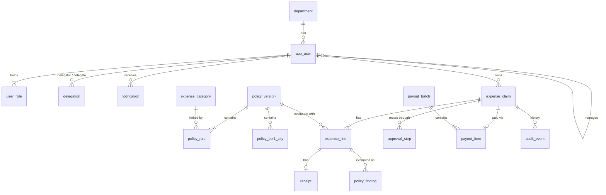
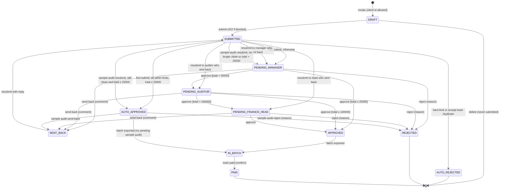

# ExpenseFlow data model

PostgreSQL 18. Flyway owns the schema (`backend/src/main/resources/db/migration`); Hibernate only validates.
API contract: [`api/openapi.yaml`](api/openapi.yaml). Sources: `requirements/track-a-usecase.md`,
`requirements/screen-list.md`, `requirements/ExpenseFlow_Stories_and_Acceptance_Criteria.xlsx`.

## Conventions

| Topic | Rule |
|---|---|
| Primary keys | `uuid`. Server default `uuidv7()`; claims and lines may instead carry a **client-generated** UUID (offline sync, US3-AC3). Inserts use `ON CONFLICT (id) DO NOTHING`; on conflict the stored row is compared with the request: same content → return it (200), different content or different owner/claim → 409. `audit_event` uses `bigint` identity for strict ordering. |
| Money | `numeric(12,2)` INR; batch and dashboard totals `numeric(14,2)`. Line amounts `CHECK (amount > 0)`. |
| Time | `timestamptz` in UTC. Business dates (`expense_date`, trip, delegation range) are `date` in Asia/Kolkata. |
| Enums | `varchar` + `CHECK (col IN (...))`. |
| Optimistic locking | `version integer NOT NULL DEFAULT 0` on `app_user`, `expense_claim`, `payout_batch`. |
| Deletes | Hard delete only for never-submitted drafts (and their lines/receipts). Everything else is kept. |
| Extensions | `citext`, `btree_gist`. |

## Entity overview

## Tables

### department

| Column | Type | Null | Notes |
|---|---|---|---|
| id | uuid | no | PK |
| code | varchar(20) | no | UNIQUE |
| name | varchar(100) | no | UNIQUE |

Seed: 8 departments (use case).

### app_user

| Column | Type | Null | Notes |
|---|---|---|---|
| id | uuid | no | PK |
| email | citext | no | UNIQUE |
| full_name | varchar(120) | no | |
| employee_code | varchar(20) | no | UNIQUE |
| department_id | uuid | no | FK → department |
| manager_id | uuid | yes | FK → app_user; `CHECK (manager_id <> id)`; cycles rejected by the app |
| bank_account_number | varchar(18) | yes | mock, `^\d{9,18}$` |
| ifsc_code | char(11) | yes | mock, `^[A-Z]{4}0[A-Z0-9]{6}$` |
| password_hash | varchar(100) | no | BCrypt hash; the plain password is never stored or logged |
| active | boolean | no | inactive users cannot sign in (same 401 as a wrong password) |
| version | integer | no | |
| created_at, updated_at | timestamptz | no | |

S1 signs in with email + password (BCrypt). Seeded users get `firstname.lastname@expenseflow.test` and one shared demo password from env `SEED_USER_PASSWORD` (set only in `.env`; see `docs/demo-accounts.md`). The JWT carries all of the user's roles; home screen = highest role. Indexes: `(manager_id)`, `(department_id)`; `email` is UNIQUE (citext, case-insensitive).
Seed: 150 employees with a reporting hierarchy (use case).

### user_role

| Column | Type | Null | Notes |
|---|---|---|---|
| user_id | uuid | no | FK → app_user ON DELETE CASCADE |
| role | varchar(20) | no | `EMPLOYEE`, `MANAGER`, `AUDITOR`, `FINANCE_HEAD` |

PK `(user_id, role)`; index `(role, user_id)`. Every user has `EMPLOYEE`.

### delegation

| Column | Type | Null | Notes |
|---|---|---|---|
| id | uuid | no | PK |
| delegator_id | uuid | no | FK → app_user |
| delegate_id | uuid | no | FK → app_user; `CHECK (delegate_id <> delegator_id)` |
| starts_on | date | no | |
| ends_on | date | no | `CHECK (ends_on >= starts_on)` |
| reason | varchar(500) | yes | |
| created_at | timestamptz | no | |
| revoked_at | timestamptz | yes | soft revoke |

- `EXCLUDE USING gist (delegator_id WITH =, daterange(starts_on, ends_on, '[]') WITH &&) WHERE (revoked_at IS NULL)`.
- Index `(delegate_id, starts_on, ends_on) WHERE revoked_at IS NULL`.
- **Active** = `revoked_at IS NULL AND current_date BETWEEN starts_on AND ends_on` (Asia/Kolkata). It is computed on every read, so a delegation ends by itself after `ends_on` with no job (US7-AC3).
- Covered roles = approver roles held by both delegator and delegate. Not transitive: a delegate cannot act on work that reached them through someone else's delegation.

### expense_category (seeded)

| Column | Type | Null | Notes |
|---|---|---|---|
| code | varchar(30) | no | PK: `MEALS`, `HOTEL`, `LOCAL_CAB`, `AIRFARE`, `TRAIN`, `OTHER` |
| name | varchar(60) | no | |
| requires_hotel_details | boolean | no | true for `HOTEL` |
| active | boolean | no | |

### policy_version (F4, versioned config)

Every change on F4 inserts a new row; rows are never updated.

| Column | Type | Null | Notes |
|---|---|---|---|
| id | uuid | no | PK |
| version_no | integer | no | UNIQUE; 1, 2, 3, … |
| change_note | varchar(500) | yes | |
| created_by | uuid | yes | FK → app_user; null for the seed (US15-AC2 author) |
| created_at | timestamptz | no | US15-AC2 date |
| receipt_threshold | numeric(12,2) | no | seed 500.00 |
| weekend_flag_enabled | boolean | no | seed true |
| overdue_threshold_hours | integer | no | seed 48; used for Overdue items and the oldest-pending alert (US18-AC1) |
| auto_approve_max_total | numeric(12,2) | no | seed 25000.00 |
| auditor_above_total | numeric(12,2) | no | seed 25000.00 (strictly above) |
| finance_head_above_total | numeric(12,2) | no | seed 100000.00 (strictly above) |
| sample_audit_percent | smallint | no | seed 10 |

Current version = highest `version_no`. Publishing takes `SELECT … FOR UPDATE` on the current row and checks `basedOnVersionNo` (409 on mismatch).

### policy_rule

| Column | Type | Null | Notes |
|---|---|---|---|
| id | uuid | no | PK |
| policy_version_id | uuid | no | FK → policy_version |
| code | varchar(50) | no | UNIQUE `(policy_version_id, code)` |
| name | varchar(80) | no | shown as `ruleName` in findings |
| category | varchar(30) | no | FK → expense_category |
| unit | varchar(10) | no | `PER_DAY`, `PER_NIGHT`, `PER_TRIP` |
| city_tier | varchar(6) | yes | `TIER1`, `OTHER` (hotel only) |
| soft_limit | numeric(12,2) | no | over → ROUTE |
| hard_limit | numeric(12,2) | no | over → AUTO_REJECT; `CHECK (hard_limit >= soft_limit)` |

Seed (hard = 2 × soft): `MEALS_DAILY` 1500/3000 per day; `HOTEL_NIGHTLY_TIER1` 6000/12000 per night; `HOTEL_NIGHTLY_OTHER` 4000/8000 per night; `LOCAL_CAB_TRIP` 2000/4000 per trip.

### policy_tier1_city

| Column | Type | Null | Notes |
|---|---|---|---|
| policy_version_id | uuid | no | FK → policy_version |
| city_key | varchar(80) | no | `lower(trim(city))`, inner spaces collapsed |
| display_name | varchar(80) | no | |

PK `(policy_version_id, city_key)`. Seed: Ahmedabad, Bengaluru, Chennai, Delhi, Hyderabad, Kolkata, Mumbai, Pune.

### expense_claim

| Column | Type | Null | Notes |
|---|---|---|---|
| id | uuid | no | PK; may be client-generated |
| claim_number | varchar(20) | no | UNIQUE, `CL-` + `claim_number_seq` zero-padded to 6 digits (`CL-000123`); searchable in every claim list (`q`) |
| employee_id | uuid | no | FK → app_user (owner) |
| department_id | uuid | no | FK → department; refreshed at each submit |
| title | varchar(150) | no | |
| purpose | varchar(1000) | yes | |
| trip_start_date | date | yes | |
| trip_end_date | date | yes | `CHECK (trip_end_date >= trip_start_date)` |
| currency | char(3) | no | `CHECK (currency = 'INR')` |
| status | varchar(25) | no | 12 statuses, see state machine |
| total_amount | numeric(12,2) | no | |
| submission_no | integer | no | 0 until first submit |
| policy_version_id | uuid | yes | FK → policy_version; version in force at the latest submit (claim-level thresholds) |
| policy_outcome | varchar(15) | yes | worst line outcome |
| decision_reason | varchar(2000) | yes | REJECTED: approver's reason; AUTO_REJECTED: summary of findings |
| sample_audit | boolean | no | sample tag |
| sample_audit_status | varchar(10) | yes | `PENDING`, `CLEARED`, `REJECTED`, `SENT_BACK` |
| sample_audited_by | uuid | yes | FK → app_user (US11-AC3) |
| sample_audited_at | timestamptz | yes | (US11-AC3) |
| payout_batch_id | uuid | yes | FK → payout_batch; set when reserved in a batch |
| submitted_at | timestamptz | yes | latest submit |
| decided_at | timestamptz | yes | reached APPROVED / AUTO_APPROVED / REJECTED / AUTO_REJECTED |
| paid_at | timestamptz | yes | |
| version | integer | no | |
| created_at, updated_at | timestamptz | no | |

Checks: `sample_audit = false OR status IN ('AUTO_APPROVED','SENT_BACK','REJECTED','IN_BATCH','PAID')`; `decision_reason IS NOT NULL` when status is `REJECTED` or `AUTO_REJECTED`.
Indexes: `(employee_id, status, updated_at DESC)` (E1 + status chips), `(status, submitted_at)`, `(department_id, status)`, `(sample_audit_status) WHERE sample_audit`, `(decided_at) WHERE status IN ('APPROVED','AUTO_APPROVED','IN_BATCH','PAID')`.

### expense_line

| Column | Type | Null | Notes |
|---|---|---|---|
| id | uuid | no | PK; may be client-generated |
| claim_id | uuid | no | FK → expense_claim ON DELETE CASCADE (drafts only) |
| employee_id | uuid | no | denormalised from the claim, for duplicate and meals indexes |
| line_no | smallint | no | UNIQUE `(claim_id, line_no)` |
| category | varchar(30) | no | FK → expense_category |
| amount | numeric(12,2) | no | `CHECK (amount > 0)` |
| expense_date | date | no | not in the future (400 on save, 422 on submit) |
| vendor | varchar(150) | no | |
| vendor_key | varchar(150) | no | generated: lowercased, trimmed, spaces collapsed |
| notes | varchar(500) | yes | |
| city | varchar(80) | yes | hotel only |
| nights | smallint | yes | hotel only, 1–60 |
| policy_outcome | varchar(15) | yes | stored result |
| evaluated_policy_version_id | uuid | yes | FK → policy_version; version of the stored result |
| evaluated_at | timestamptz | yes | |
| needs_evaluation | boolean | no | true on insert and whenever amount, date, vendor, category, city, nights or receipt change; cleared when evaluated |
| created_at, updated_at | timestamptz | no | |

Check: `(category = 'HOTEL') = (city IS NOT NULL AND nights IS NOT NULL)`.
Indexes: `(employee_id, vendor_key, amount, expense_date)` (duplicate), `(employee_id, category, expense_date)` (meals per day), `(claim_id)`.

### receipt

| Column | Type | Null | Notes |
|---|---|---|---|
| id | uuid | no | PK |
| line_id | uuid | no | FK → expense_line ON DELETE CASCADE; UNIQUE |
| storage_key | varchar(255) | no | UNIQUE |
| file_name | varchar(255) | no | |
| content_type | varchar(50) | no | pdf / jpeg / png |
| size_bytes | integer | no | ≤ 5 MB |
| sha256 | char(64) | no | computed by the server (E5 "file hash") |
| uploaded_by | uuid | no | FK → app_user |
| uploaded_at | timestamptz | no | |

Index `(sha256)`, deliberately not unique: a reused receipt must be stored so it can be auto-rejected as `DUPLICATE_RECEIPT`.

### policy_finding

Stored result per line (replaced only when that line is re-evaluated) plus claim-level findings.

| Column | Type | Null | Notes |
|---|---|---|---|
| id | uuid | no | PK |
| claim_id | uuid | no | FK → expense_claim |
| line_id | uuid | yes | FK → expense_line ON DELETE CASCADE; null = claim-level |
| policy_version_id | uuid | no | FK → policy_version |
| rule_code | varchar(50) | no | rule code or flag code (`WEEKEND`, `DUPLICATE`, `DUPLICATE_RECEIPT`, `NO_POLICY_RULE`, `AUTO_APPROVE_MAX_TOTAL`) |
| rule_name | varchar(80) | no | |
| reason_code | varchar(50) | no | see OpenAPI `ReasonCode` |
| outcome | varchar(15) | no | |
| message | varchar(500) | no | |
| limit_type | varchar(4) | yes | `SOFT`, `HARD` |
| unit | varchar(10) | yes | |
| limit_value | numeric(12,2) | yes | |
| actual_value | numeric(12,2) | yes | |
| excess_value | numeric(12,2) | yes | |
| matched_claim_id | uuid | yes | duplicates (US2-AC2, US6-AC3) |
| matched_line_id | uuid | yes | duplicates |
| evaluated_at | timestamptz | no | |

Indexes: `(line_id)`, `(claim_id) WHERE line_id IS NULL`, `(reason_code, evaluated_at)` for the dashboard.
History of earlier results is kept in `audit_event.details` (`POLICY_EVALUATED` details per submit), not here.

### sample_audit_block

Gives **exactly** one sampled claim in every 10 auto-approved claims (US11-AC1).

| Column | Type | Null | Notes |
|---|---|---|---|
| block_no | integer | no | PK |
| target_position | smallint | no | 1–10, chosen with `SecureRandom` when the block opens |
| filled | smallint | no | 0–10 |

At auto-approve: lock the open block (`FOR UPDATE`), `filled += 1`; if `filled = target_position` the claim is tagged; when `filled = 10` open the next block. Exactness holds per completed block (see ac-traceability open items). Percent comes from `sample_audit_percent` (block size = 100 / percent).

### approval_step

| Column | Type | Null | Notes |
|---|---|---|---|
| id | uuid | no | PK |
| claim_id | uuid | no | FK → expense_claim |
| sequence | smallint | no | UNIQUE `(claim_id, sequence)` |
| step_type | varchar(20) | no | `MANAGER`, `AUDITOR`, `FINANCE_HEAD`, `SAMPLE_AUDIT`; UNIQUE `(claim_id, step_type)` |
| required_role | varchar(20) | no | MANAGER / AUDITOR / FINANCE_HEAD (a MANAGER-type step for an owner with no manager requires FINANCE_HEAD) |
| sent_back_by | uuid | yes | FK → app_user; who sent the claim back from this step (assignee if a delegate acted) |
| assignee_id | uuid | yes | named approver. MANAGER: owner's manager; an owner with no manager gets null with `required_role = FINANCE_HEAD` (finance-head pool minus the owner). Pool steps: null, except after a send-back (see resubmit routing below). |
| status | varchar(15) | no | `WAITING`, `PENDING`, `APPROVED`, `REJECTED`, `SENT_BACK`, `CANCELLED` |
| pending_since | timestamptz | yes | drives Overdue, oldest pending, approval age |
| acted_by | uuid | yes | FK → app_user |
| acted_on_behalf_of | uuid | yes | FK → app_user (delegation) |
| acted_at | timestamptz | yes | |
| comment | varchar(2000) | yes | latest action's comment; full history in audit_event |

Constraints: partial UNIQUE `(claim_id) WHERE status = 'PENDING'`; trigger rejects `acted_by` = claim owner.
Indexes: `(assignee_id) WHERE status = 'PENDING'`, `(required_role, pending_since) WHERE status = 'PENDING'`, `(acted_by, acted_at)` for the inbox's Sent back and Decided tabs.

Chain at first submit (non-auto-approved): MANAGER; + AUDITOR if total > 25000; + FINANCE_HEAD if total > 100000.

**Resubmit routing** (US4-AC2): the `SENT_BACK` step goes back to `PENDING` and is routed by the normal rules at that moment:
1. Assignee = `sent_back_by`. An active delegation from that person applies as usual (delegate sees it, `onBehalfOf` recorded).
2. If `sent_back_by` is now inactive: a MANAGER step goes to *their* manager (`app_user.manager_id`), or the finance-head pool if they have none. An AUDITOR or FINANCE_HEAD step goes back to its role pool (`assignee_id = null`).
3. Missing later steps are appended if the new total crosses 25000 or 100000. Steps are never removed.

**Sample-audit send-back resubmit:** policy reruns (new and edited lines). If every line is AUTO_APPROVE and total ≤ 25000, status returns to `AUTO_APPROVED`, `sample_audit_status = PENDING`, and the SAMPLE_AUDIT step is assigned to the same auditor (pool if inactive). Otherwise the SAMPLE_AUDIT step is `CANCELLED`, `sample_audit` is cleared, and the normal chain is created from MANAGER (or the claim becomes `AUTO_REJECTED` on a hard breach or receipt-hash duplicate).

### notification (S2)

| Column | Type | Null | Notes |
|---|---|---|---|
| id | uuid | no | PK |
| recipient_id | uuid | no | FK → app_user |
| type | varchar(20) | no | `APPROVAL_WAITING`, `SENT_BACK`, `PAYOUT_DONE`, `CLAIM_DECIDED` |
| claim_id | uuid | yes | FK → expense_claim |
| payout_batch_id | uuid | yes | FK → payout_batch |
| title | varchar(150) | no | |
| message | varchar(500) | no | |
| created_at | timestamptz | no | |
| read_at | timestamptz | yes | |

Index `(recipient_id, created_at DESC)`, partial `(recipient_id) WHERE read_at IS NULL` (badge count).
Pool steps notify every holder of the role (minus the owner) and their active delegates.

### payout_batch

| Column | Type | Null | Notes |
|---|---|---|---|
| id | uuid | no | PK |
| batch_number | varchar(20) | no | UNIQUE `PAY-<yyyy>-<4 digits>` |
| status | varchar(10) | no | `CREATED`, `EXPORTED`, `PAID` |
| claim_count | integer | no | |
| total_amount | numeric(14,2) | no | |
| created_by | uuid | no | FK → app_user |
| created_at | timestamptz | no | |
| exported_at | timestamptz | yes | first CSV download; claims → IN_BATCH |
| paid_at | timestamptz | yes | |
| paid_by | uuid | yes | FK → app_user |
| bank_reference | varchar(64) | yes | |
| version | integer | no | |

### payout_item

| Column | Type | Null | Notes |
|---|---|---|---|
| id | uuid | no | PK |
| batch_id | uuid | no | FK → payout_batch |
| claim_id | uuid | no | FK → expense_claim; **UNIQUE** (never paid twice) |
| employee_id | uuid | no | FK → app_user |
| amount | numeric(12,2) | no | |
| bank_account_number | varchar(18) | no | snapshot |
| ifsc_code | char(11) | no | snapshot |

### audit_event (append-only)

| Column | Type | Null | Notes |
|---|---|---|---|
| id | bigint | no | identity PK |
| occurred_at | timestamptz | no | when (US17-AC1) |
| actor_id | uuid | yes | who (US17-AC1) |
| on_behalf_of_id | uuid | yes | delegator when a delegate acted |
| action | varchar(40) | no | OpenAPI `AuditAction`, incl. `LOGIN` |
| entity_type | varchar(20) | no | |
| entity_id | varchar(64) | no | |
| claim_id | uuid | yes | no FK, so events outlive deleted drafts |
| from_status | varchar(25) | yes | |
| to_status | varchar(25) | yes | |
| comment | varchar(2000) | yes | comments, send-back comments, reject reasons, replies |
| details | jsonb | yes | what changed (US17-AC1): `{changes: {field: {from, to}}}`, step, policy version, batch totals |
| request_id | varchar(64) | yes | |

Indexes: `(claim_id, occurred_at, id)`, `(actor_id, occurred_at)`, `(action, occurred_at)`, `(occurred_at)`.
Append-only (US17-AC2): `BEFORE UPDATE OR DELETE` and `BEFORE TRUNCATE` triggers raise; app DB role has only `INSERT, SELECT`; no API to edit or delete. Claim `statusHistory` and `comments` (US4-AC1) are read from this table.

## Policy engine

Runs at submit on lines with `needs_evaluation = true`, using the **current** version; other lines keep their stored findings and version (US15-AC3).

**Lines in scope** (duplicates and the meals day total): lines of claims in `SUBMITTED` or any later status, including `SENT_BACK` (not `DRAFT`, `AUTO_REJECTED`, `REJECTED`), plus earlier lines (lower `line_no`) of the claim being submitted. For the vendor duplicate only the same employee's lines count; for the receipt hash, any employee's.

| Check | Rule | Outcome |
|---|---|---|
| Receipt | amount > `receipt_threshold` and no receipt | **blocks submit (422)**, no finding |
| Future date | `expense_date` > today | **blocks submit (422)** |
| Duplicate receipt | same `sha256` on an in-scope line (any employee) | AUTO_REJECT `DUPLICATE_RECEIPT`; matched claim/line stored, but returned **only** when it is the same employee's. Another employee's match is a message only, never ids |
| Duplicate entry | in-scope line of the same employee with same `vendor_key`, `amount`, `expense_date` | ROUTE `DUPLICATE` + matched claim/line |
| Limit rule | value per unit (meals: day total over in-scope lines; hotel: amount ÷ nights by city tier; cab: amount) > hard | AUTO_REJECT `HARD_LIMIT_EXCEEDED` (limit = hard, excess) |
| | > soft | ROUTE `SOFT_LIMIT_EXCEEDED` (limit = soft, excess) |
| | otherwise | AUTO_APPROVE `WITHIN_LIMIT` (limit = soft, excess 0.00) |
| Weekend | Saturday/Sunday and `weekend_flag_enabled` | ROUTE `WEEKEND_EXPENSE` (flag only) |
| No rule | no rule for the category in the version | ROUTE `NO_POLICY_RULE` |

Line outcome = worst finding; claim outcome = worst line. Then: any AUTO_REJECT → `AUTO_REJECTED` (final); first submit, all AUTO_APPROVE and total ≤ `auto_approve_max_total` → `AUTO_APPROVED` (+ sample block); otherwise chain. Evaluation holds `pg_advisory_xact_lock(employee)` so concurrent submits can't both slip under the meals cap or miss a duplicate; the receipt-hash check also locks on the hash.

## Claim state machine

Notes:
- `SUBMITTED` is transient (one transaction) but both transitions are audited.
- Editable by the owner: `DRAFT`, `SENT_BACK`. `AUTO_REJECTED` and `REJECTED` are final, with `decision_reason`.
- Sample tag: `sample_audit = true` on an `AUTO_APPROVED` claim; clearing it keeps `AUTO_APPROVED` and makes it payout-eligible. Tagged claims show only in A4.
- A claim is reserved for a batch (`payout_batch_id`) at batch creation and moves to `IN_BATCH` on export (US13-AC3).
- Every transition bumps `version` and writes one `audit_event` with from/to status in the same transaction.
